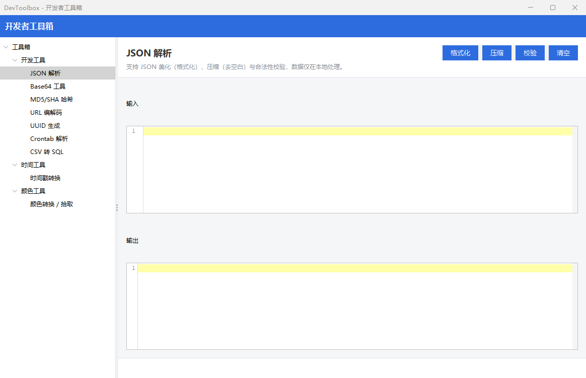
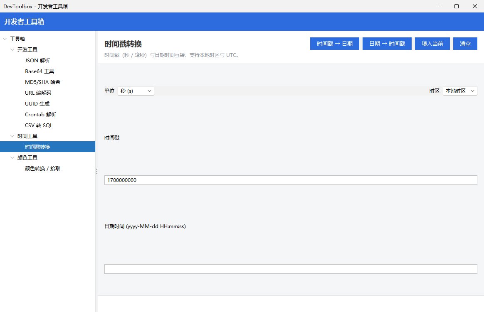

# MybatisLogTools · 开发辅助工具箱

一个基于 Java Swing 的桌面开发辅助工具集合，内置 JSON / Base64 / 哈希 / URL / UUID / 时间戳 / 颜色 / Crontab / CSV 转 SQL 等常用工具，左侧分类导航、右侧卡片式工作区，开箱即用。

> 项目原名 MybatisLogTools，现已扩展为通用开发小工具箱，后续将持续补充更多实用工具。

## ✨ 功能特性

- **零依赖运行**：`mvn package` 后产出单个可执行 jar，双击或 `java -jar` 即可启动，无需安装。
- **分类导航**：左侧树形菜单按功能分类，点击即切换，无需在多个窗口间来回跳转。
- **即时转换**：输入即出结果，结果区可一键复制，部分工具支持语法高亮。
- **深色主题**：基于 FlatLaf 现代化 UI，长时间使用不刺眼。
- **中文友好**：内置微软雅黑等宽字体，SQL / JSON 等结果中的中文正常显示，无乱码。

## 🛠 内置工具一览

| 分类 | 工具 | 说明 |
|------|------|------|
| 开发工具 | JSON 解析 | 格式化 / 压缩 / 语法校验，支持语法高亮 |
| 开发工具 | Base64 工具 | 标准与 URL 安全两种模式编解码 |
| 开发工具 | MD5 / SHA 哈希 | MD5 / SHA-1 / SHA-256 / SHA-512 计算 |
| 开发工具 | URL 编解码 | URL 编码 / 解码 |
| 开发工具 | UUID 生成 | 批量生成 UUID |
| 时间戳 | 时间戳转换 | 秒 / 毫秒时间戳 ↔ 日期互转 |
| 颜色 | 颜色转换 / 拾取 | HEX ↔ RGB 互转，带颜色预览 |
| 定时任务 | Crontab 解析 | 解析 cron 表达式并给出自然语言描述 |
| 数据 | CSV 转 SQL | CSV 文本转 INSERT 语句，支持表头 / 分隔符 / 引号策略 |

## 🚀 快速开始

### 环境要求

- JDK 8 及以上
- Maven 3.x（仅用于构建）

### 构建

```bash
git clone <repo-url>
cd MybatisLogTools
mvn clean package
```

构建完成后，在 `target/` 目录下会生成可执行 jar，例如 `mybatis-log-tools-1.0.0.jar`。

### 运行

```bash
java -jar target/mybatis-log-tools-1.0.0.jar
```

启动后进入主界面，左侧为分类导航树，右侧为工具工作区：



## 📖 工具使用说明

### JSON 解析

支持 JSON 格式化（美化缩进）、压缩（去空白）与语法校验。粘贴 JSON 后点击对应按钮即可，错误会以状态条提示。`张三 / 李四` 等中文内容正常显示。


### Base64 工具

切换「标准」或「URL 安全」模式，输入文本后一键编码 / 解码。


### MD5 / SHA 哈希

选择算法（MD5 / SHA-1 / SHA-256 / SHA-512），输入文本实时计算摘要，可切换大小写。


### URL 编解码

对查询参数、含中文的 URL 进行编码或解码。


### UUID 生成

一键生成 UUID，支持批量生成多行。


### 时间戳转换

支持秒级 / 毫秒级时间戳与日期互转，自动识别输入类型。



### 颜色转换 / 拾取

HEX 与 RGB 互转，输入后实时显示颜色预览块，方便核对配色。


### Crontab 解析

输入 cron 表达式（如 `0 0 2 * * ?`），自动解析并给出可读的下次执行描述。


### CSV 转 SQL

将 CSV 文本转换为 `INSERT` 语句。可设置表名、字段分隔符、是否首行作为表头、引号包裹策略，并支持合并为单条多值 `INSERT`。中文数据正常保留。


## 🧩 扩展新工具

工具均继承 `com.devtoolbox.core.ToolPanel`，并实现 `build(ToolShell)` 方法：

1. 在 `com.devtoolbox.tools` 包下新建工具类，继承 `ToolPanel`；
2. 在构造器中设置 `category`（分类）、`title`（名称）、`description`（说明）；
3. 在 `build(ToolShell shell)` 中实现 UI 与交互逻辑；
4. 在 `MainFrame#initRegistry()` 中调用 `ToolRegistry.register(new YourTool())` 完成登记。

纯算法建议放在 `com.devtoolbox.core.Algorithms`（静态方法），UI 委托调用，便于单元测试。

> **约定**：代码 / 文本区字体统一使用 `Ui.MONO_FONT`（微软雅黑），不要直接 `new Font("Consolas", ...)` —— Consolas 不含中文字形，会导致结果中的中文显示为乱码。

## 🧪 测试

```bash
mvn test
```

核心算法（JSON / Base64 / 哈希 / URL / UUID / 时间戳 / 颜色 / Crontab / CSV 等）均有 JUnit 5 单元测试覆盖，入口为 `AlgorithmsTest`。

## 📦 技术栈

- **语言 / 构建**：Java 8 / Maven
- **UI**：Swing + FlatLaf（主题）+ MigLayout（布局）+ RSyntaxTextArea（代码高亮）
- **JSON**：Gson

## 📁 目录结构

```
src/main/java/com/devtoolbox/
├── DevToolboxApp.java        # 启动入口
├── core/                     # 框架核心：Ui / ToolPanel / ToolShell / ToolRegistry / Algorithms / MainFrame
└── tools/                    # 各具体工具实现
src/test/java/...             # 单元测试 + 截图脚本
docs/screenshots/             # 工具界面截图
```

## 📄 许可证

内部开发工具，可自由使用与二次开发。
